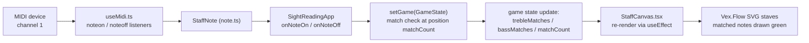

# Sight Reading Application

Internal documentation of how the sight-reading app works: the MIDI → UI flow, how the events work (so you know where to edit things), and the purpose of each file and class.

## Files at a glance

| File | Role |
| --- | --- |
| `note.ts` | Note model (`StaffNote`) and random note generation (`NoteDistribution`, `NoteProducer`). Pure logic, no React. |
| `useMidi.ts` | WebMIDI wrapper hook. Turns raw MIDI messages into `StaffNote` events and exposes device management. |
| `SightReadingApp.tsx` | The game itself: state machine, settings UI, and the glue between MIDI events and the staff display. |
| `StaffCanvas.tsx` | Presentational component that renders the treble/bass staves with Vex.Flow (SVG). |

## MIDI → UI flow

The full path a physical key press takes to reach the screen:



Step by step:

1. **MIDI input** — `useMidi` attaches `noteon`/`noteoff` listeners to **channel 1** of the connected WebMIDI input. Each event's note is converted to a `StaffNote` (WebMidi leaves `accidental` undefined for naturals, so it is normalized to `''`).
2. **Callbacks into the app** — the hook calls `callbacksRef.current.onNoteOn(note)` / `onNoteOff(note)`. The callbacks live in a ref that is refreshed on every render, so the MIDI listeners are attached **once per connection** but always see the latest game state (no re-subscribing).
3. **Match check** — `onNoteOn` runs inside `setGame(prev => ...)`. It compares the played note against the *next expected* notes: `prev.trebleNotes[prev.matchCount]` and `prev.bassNotes[prev.matchCount]`, gated by `rhEnabled`/`lhEnabled` (hand mode). A match flips the corresponding entry in `trebleMatches`/`bassMatches`.
4. **Position advance** — a position is "done" when every *enabled* hand has matched it (`(trebleMatches[pos] || !rhEnabled) && (bassMatches[pos] || !lhEnabled)`). Only then does `matchCount` advance to `pos + 1`. `onNoteOff` un-matches the current position (pressing and releasing a wrong-then-right note can't cheat; releasing the correct note clears the highlight until re-pressed).
5. **Round completion** — when `matchCount === noteCount`, the timer is cleared and a new round is scheduled after `noteDelay` seconds: `setGame(freshState(producer, interval, noteCount))`. While the timer is pending, further notes are ignored (`prev.matchCount >= noteCount` guard).
6. **UI update** — the new `GameState` re-renders `StaffCanvas`, whose `useEffect` (dependent on all note/match/enable props) rebuilds the Vex.Flow SVG from scratch. Matched notes get a green fill/stroke style; unmatched ones stay white.

### Where to edit things

| Want to change… | Edit here |
| --- | --- |
| Which MIDI channel is listened to | `useMidi.ts` — `input.channels[1]` (in `connect` and `disconnect`) |
| Note → `StaffNote` conversion / accidental handling | `useMidi.ts` — the `noteon`/`noteoff` listeners |
| Device list, connect/disconnect behavior | `useMidi.ts` — `refresh`, `connect`, `disconnect`, `portschanged` effect |
| Match rules (which hand must match, how positions advance) | `SightReadingApp.tsx` — `onNoteOn` / `onNoteOff` |
| Round length, delay between rounds, interval | `SightReadingApp.tsx` — settings state (`noteCount`, `noteDelay`, `interval`) and the completion block in `onNoteOn` |
| Note ranges (treble/bass low/high) | `SightReadingApp.tsx` — `updateTrebleRange` / `updateBassRange` (they also call `producer.setTrebleRange`/`setBassRange` and regenerate the round) |
| How notes are generated (melodic drift, histogram bias) | `note.ts` — `NoteDistribution` / `NoteProducer` |
| Staff appearance (colors, sizes, stem direction, labels) | `StaffCanvas.tsx` — `buildStaveVoices` and the render `useEffect` |
| Note duration shown on staff (whole/half/quarter) | `StaffCanvas.tsx` — `noteDuration(noteCount)` |
| Hand mode options | `SightReadingApp.tsx` — `HandMode` type and the "Hand" card |

## Game state

`GameState` (in `SightReadingApp.tsx`) is the single source of truth:

```ts
interface GameState {
  trebleNotes: StaffNote[];   // expected notes for the right hand, one per position
  bassNotes: StaffNote[];     // expected notes for the left hand
  trebleMatches: boolean[];   // which positions are currently matched (RH)
  bassMatches: boolean[];     // which positions are currently matched (LH)
  matchCount: number;         // index of the position being played next
}
```

- `freshState(producer, interval, count)` produces a new round by calling `producer.produce(interval, count)` and resetting all matches.
- The `NoteProducer` is created **once** (via lazy `useState`) and mutated in place; range changes replace its internal distributions via `setTrebleRange`/`setBassRange`.
- A round can also be regenerated manually by clicking the staff or changing note count/ranges (`produce(count, interval)`).

## File and class reference

### `note.ts`

- **`NOTE_NAMES`** — `['C','D','E','F','G','A','B']`, the pitch-class order used for index math.
- **`StaffNote`** — an immutable note identified by a flat integer `index` (0 = A0). Two constructor forms: from a flat index, or from `(name, accidental, octave)`. Comparison is done on `index` via `eq`/`gt`/`lt`; `toString()` renders e.g. `C/4`. This is the shared currency between MIDI input, generation, and rendering.
- **`NoteDistribution`** — generates random notes inside `[beginNote, endNote]` using a sliding 3-note window (`winLow`..`winHigh`). A per-note histogram makes recently used notes less likely to repeat (probability ∝ `(maxCount - count)²`), so output feels melodic. `moveWindowRandom(step)` drifts the window, clamped to the range; `pmfSampling` does cumulative-probability sampling. Consecutive identical notes are rejected by resampling.
- **`NoteProducer`** — owns one treble and one bass `NoteDistribution` and drives the window drift across rounds. `produce(interval, count)` samples a step from `-interval..+interval` (biased toward small steps: weight 2 for 0, `1/k` for ±k), moves both windows, and returns `{ treble, bass }` note arrays. It also tracks boundary stickiness: if both windows sit at the low boundary for >6 rounds it resets to free drift; at the high boundary it flips `direction` to push down.

### `useMidi.ts`

- **`useMidi({ onNoteOn, onNoteOff })`** — returns `{ devices, status, refresh, connect, disconnect }`.
  - `status`: `'unsupported' | 'disconnected' | 'connected'`.
  - `refresh()`: enables WebMIDI and lists input device names.
  - `connect(name)`: finds the input by name, attaches a raw `midimessage` logger (debug), plus `noteon`/`noteoff` listeners on **channel 1** that build `StaffNote`s and forward them through `callbacksRef`.
  - `disconnect()`: removes the channel listeners and resets status.
  - A `portschanged` listener keeps the device list current while enabled; unmount disconnects.
  - The `callbacksRef` pattern (updated in a `useEffect` on every render) decouples listener lifetime from React re-renders.

### `SightReadingApp.tsx`

- **`SightReadingApp`** — the main component. Holds:
  - *Settings state*: `handMode` (`'lh' | 'rh' | 'bt'`), `noteCount`, `noteDelay`, `interval`, `trebleRange`/`bassRange` (each a `{ low, high }` of `StaffNote`), `showLabels`.
  - *Game state*: the single `NoteProducer` instance and the `GameState`, plus `timerRef` for the round-advance timeout.
  - *Event handlers*: `onNoteOn`/`onNoteOff` (the match logic described above) and `produce(count, stepInterval)` (clears the timer, starts a fresh round).
  - *Range handlers*: `updateTrebleRange`/`updateBassRange` validate ordering (high > low), update both React state and the producer, then regenerate the round. Invalid candidates are rejected with a `console.log`.
- **`Card`** — small titled panel wrapper for the settings column.
- **`RangeRow`** — a note-name `<select>` + octave number input pair used by the treble/bass range cards.
- **`MidiPanel`** — device dropdown, connect/disconnect button, refresh button, and status text; consumes the `useMidi` result.

### `StaffCanvas.tsx`

- **`StaffCanvas`** — presentational only. On every prop change its `useEffect` clears the container and re-renders with Vex.Flow (SVG backend, 250×300):
  - Treble stave at y≈30.5 when `rhEnabled`; bass stave at y≈160.5 when `lhEnabled`, both 4/4.
  - `buildStaveVoices(stave, notes, matches)` converts each `StaffNote` to a Vex.Flow `StaveNote` (duration from `noteDuration`: 1→whole, 2→half, 4→quarter), green-styling matched notes and forcing stems down for notes above the staff center (B4 treble / D3 bass). It also builds a parallel `TextNote` voice with `Name+octave` labels.
  - Label voices are `joinVoices`-ed with the note voices so text overlays at the same x positions; labels are only formatted/drawn when `showLabels` is true.
- **`noteDuration(noteCount)`** — maps round size to a Vex.Flow duration string.

## Notes / gotchas

- The app listens to MIDI **channel 1 only**; devices transmitting on another channel will appear connected but silent.
- `onNoteOff` only affects the *current* position (`matchCount`); releasing an already-advanced note does nothing.
- After a round completes, input is ignored until the `noteDelay` timer fires and a fresh round is generated — clicking the staff regenerates immediately instead.
- Debug `console.log`s exist in `useMidi.ts` (raw messages, noteon/noteoff) and `SightReadingApp.tsx` (`freshState`, `onNoteOn`) for tracing the flow.
